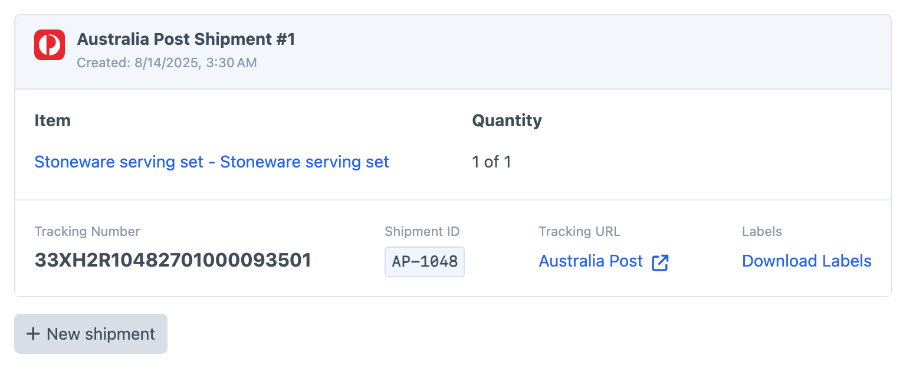

# Shipments
Postie can create shipments for Commerce orders that are lodged with the respective provider APIs. Once lodged, a tracking number and label are returned and stored alongside the order. With this information, your shop owners can print the label to start the shipment process and notify your customers of the order being shipped with the tracking number.

:::tip
Not all providers support shipments. Be sure to check each [Shipping Provider](docs:feature-tour/providers) for more details.
:::

:::warning
Be aware that most providers, if not all, charge your account each time a shipment is lodged. Be mindful when testing to set the "Is Production" value as appropriate.
:::

## Shipment Summary
The ability to add a shipment will be available in the "Shipments" tab of any Commerce order. If the chosen shipping method is a Postie-provided one, you'll be able to create a shipment with the provider the user has chosen, and for their selected service.

Orders can have multiple shipments, and can also partially ship order contents if multiple shipments are required for certain items.

Once created, a list of shipments will be shown against the order with the tracking number, tracking URL and the ability to download labels to be printed.



## Partial Shipments
When creating a shipment, you can select the number of line items and quantity you wish to ship. This will create a shipment via the provider API and record a postage label and tracking number.

Due to this, you're also able to partially ship items by selecting certain quantities or line items. 

## Order Statuses
Postie will create a **Shipped** and **Partially Shipped** order status (if they don't already exist) which will be used to change the order when creating shipments. When a shipment is created, if only partially fulfilled, the order will be marked as **Partially Shipped**. If all items in the order have been fulfilled, then the order status will change to **Shipped**.

It might be a good idea to connect a Commerce email to this change in status to notify your customers that an item has been shipped.

## Showing Shipping Details in Customer Emails

A Commerce email template, such as one sent when an order moves to **Shipped**, can show which provider is delivering the order and the tracking details for each shipment. This example goes in the email's template, where Commerce provides the `order` variable:

```twig



    <p>Your order is on its way with {{ rate.provider }} ({{ order.shippingMethodName }}).</p>



    <p>
        Tracking number: {{ shipment.trackingNumber }}

        
            <a href="{{ shipment.trackingUrl }}">Track your parcel</a>
        
    </p>

```

`craft.postie.getRateByOrder(order)` takes a Commerce order and returns the rate Postie saved when the customer completed the order with a Postie shipping method. The rate's `provider` is the shipping provider, which outputs its name, `providerHandle` is that provider's handle, `service` is the service code the customer chose and `rate` is the shipping cost Postie quoted. It returns `null` for an order that hasn't been completed or that used a shipping method from outside Postie, which is why the example checks it first.

`order.shipments` returns the shipments created for the order, each with its `trackingNumber` and a `trackingUrl` for the provider's tracking page when the provider supports one. Shipments only exist once they've been created on the order's **Shipments** tab, so an email sent earlier in the order's life shows the provider line on its own.
